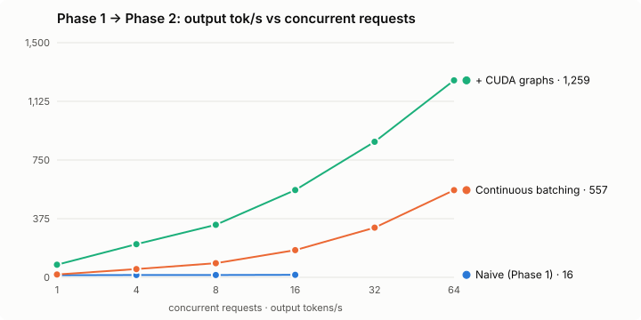

# Tensorline

A from-scratch LLM inference and serving engine — a mini vLLM. Tensorline serves open-weight
models behind an OpenAI-compatible API, and is built up phase by phase toward continuous batching,
a paged KV cache, quantisation and multi-model serving, with every claim backed by a reproducible
benchmark.

[](https://github.com/tzar-beep/Tensorline/actions/workflows/ci.yml)

> Status: **all five phases complete.** Everything below was measured on one RTX 3050 Laptop GPU (6 GB).

**Highlights**
- **2.5× Ollama's throughput** at 64 concurrent requests (1,877 vs 751 tok/s), with the same model and GPU, run back to back.
- **80× over naive one-at-a-time serving** at peak (15.8 → 1,259 tok/s, back to back), through a paged KV cache, continuous batching and CUDA graphs; later optimisations reach 1,877 tok/s.
- **Serves a 3B model that does not fit in VRAM at fp16** (728 tok/s), using hand-written fused int4/int8 Triton kernels (int8: lossless perplexity).
- **Correctness by differential testing**: the paged engine is token-identical to a reference engine under chunked prefill, preemption and prefix sharing; 70 tests (the CPU subset runs in CI; GPU tests run locally).

## Quickstart

```bash
python -m venv .venv && .venv/Scripts/activate        # Windows; use bin/activate elsewhere
pip install torch --index-url https://download.pytorch.org/whl/cu124
pip install -e .[dev]
tensorline --model Qwen/Qwen2.5-0.5B-Instruct          # serves on http://127.0.0.1:8000
tensorline --engine naive                               # Phase 1 one-at-a-time baseline
```

```bash
curl http://127.0.0.1:8000/v1/chat/completions -H "Content-Type: application/json" \
  -d '{"messages":[{"role":"user","content":"Hello!"}],"stream":true}'
```

Any OpenAI client works: `OpenAI(base_url="http://127.0.0.1:8000/v1", api_key="x")`.

## Benchmarks

Reference hardware: **NVIDIA RTX 3050 Laptop (6 GB VRAM)**, 16 GB RAM, Windows 11.
Model: Qwen2.5-0.5B-Instruct, fp16, greedy, 128 max output tokens. Harness: [`bench/bench.py`](bench/bench.py)
(streaming clients, works against any OpenAI-compatible server). Raw results live in `bench/results/`.

### Naive vs continuous batching vs batching + CUDA graphs



All three engines were run back to back by [`bench/run_compare.sh`](bench/run_compare.sh) in the
same machine state. Each level sends max(16, 2 × concurrency) streaming requests with 128 output
tokens each ([naive](bench/results/naive.json), [eager](bench/results/eager.json),
[graphs](bench/results/graphs.json)).

**Throughput (output tok/s)**

| Concurrency | Naive (Phase 1) | Batched, eager | **Batched + CUDA graphs** | vs naive |
|---:|---:|---:|---:|---:|
| 1  | 13.7 | 18.4  | **80.5**   | 5.9× |
| 4  | 14.8 | 52.9  | **211.8**  | 14× |
| 8  | 15.0 | 90.5  | **335.7**  | 22× |
| 16 | 15.8 | 174.1 | **558.1**  | 35× |
| 32 | —    | 317.6 | **866.4**  | — |
| 64 | —    | 557.5 | **1258.8** | 80× vs naive peak |

**Latency (graphs engine; naive in brackets)**

| Concurrency | TTFT p50 | TTFT p99 | Request latency p50 | Request latency p99 |
|---:|---:|---:|---:|---:|
| 1  | 77 ms (89 ms)   | 94 ms   | 1.51 s (9.16 s)  | 2.08 s |
| 8  | 132 ms (43.9 s) | 221 ms  | 2.20 s (54.1 s)  | 2.92 s |
| 16 | 299 ms (92.3 s) | 378 ms  | 2.72 s (100.3 s) | 3.61 s |
| 64 | 770 ms          | 1.36 s  | 4.77 s           | 6.56 s |

What the numbers show:
- **Continuous batching** makes throughput scale with load (18 → 558 tok/s eager), where naive
  stays flat at about 15 tok/s. It also removes queueing from TTFT: naive request N waits for
  N−1 whole generations (92 s at concurrency 16), while batched requests join on the next step.
- **CUDA graphs** fix what batching cannot: per-step overhead. Measured in-process, a decode
  step drops from **69 → 11 ms at batch 1 (6.3×)** and from **64 → 20 ms at batch 64 (3.2×)**.
  At 0.5B parameters, the eager step is a few hundred small kernels, each dispatched from
  Python. Replaying the captured graph is a single launch.
- **Where the time goes now:** the in-process decode ceiling at batch 64 is about 3,200 tok/s
  (64 tokens / 20 ms). End to end, the server reaches 1,259 tok/s, about 40% of that. The rest
  is host-side work: the Python scheduler, incremental detokenisation and SSE streaming. That is
  the next bottleneck to attack.

### vs Ollama (Phase 4)

Both servers run the same model, Qwen2.5-0.5B-Instruct fp16, on the same GPU with the same
client (`bench/bench.py`, OpenAI API, streaming, 128 output tokens), back to back via
[`bench/run_vs_ollama.sh`](bench/run_vs_ollama.sh). Ollama 0.35.1 runs with all layers on the GPU,
flash attention, a 512-token context per slot, and 16 parallel slots. With 64 slots, its
llama-server spends its time saving idle slots to a host-side prompt cache and collapses to 94
tok/s at concurrency 16 ([raw](bench/results/vs_ollama.json)).

| Concurrency | Ollama tok/s | **Tensorline tok/s** | Ollama TTFT p50 | **Tensorline TTFT p50** | Ollama latency p99 | **Tensorline latency p99** |
|---:|---:|---:|---:|---:|---:|---:|
| 1  | **124.9** | 116.2 | **24 ms** | 45 ms  | **1.04 s** | 1.47 s |
| 4  | **346.3** | 295.7 | **49 ms** | 139 ms | **1.63 s** | 2.17 s |
| 16 | 400.2 | **760.1** (1.9×) | **124 ms** | 209 ms | 5.60 s | **2.35 s** |
| 64 | 750.6 | **1877.3** (2.5×) | 5.09 s | **675 ms** | 9.38 s | **4.01 s** |

([Tensorline](bench/results/vs_tensorline.json), [Ollama, 16 slots](bench/results/vs_ollama_p16.json).)
Ollama (llama.cpp: C++ and hand-tuned CUDA, no Python on the hot path) is still ahead at 1–4
streams, by 7% single-stream, down from 24% before the fused kernels below. Tensorline wins once
batching matters: 1.9× at 16 and **2.5× at 64**, with less than half the p99 latency. Ollama
queues everything beyond its fixed slots, while Tensorline's paged KV cache and
iteration-level scheduler admit every request.

> Methodology bug found and fixed: earlier runs of this comparison showed Tensorline swinging
> between 1,014 and 1,795 tok/s at concurrency 64. The dashboard exposed the cause: a KV cache of
> only 115 blocks. Killing `ollama.exe` leaves its `llama-server.exe` children alive, so orphans
> from previous runs were holding about 4.7 GB of VRAM, and Tensorline sizes its KV cache from
> *free* VRAM at startup. `run_vs_ollama.sh` now kills `llama-server` too, the GPU is verified
> empty (6 MiB) before and after, and the engine warns when its KV cache cannot hold a modest
> batch. The table above is from that clean run.
vLLM is not compared: it does not support native Windows.

### Dashboard

`http://localhost:8000/` serves a live dashboard ([`tensorline/static/dashboard.html`](tensorline/static/dashboard.html),
no external dependencies, light/dark). It shows tiles for output tok/s, the running batch and
queue, KV-cache use, prefix-cache hit rate and windowed TTFT percentiles; 2-minute charts of
throughput and batch size with hover readouts; a streaming chat playground that reports TTFT,
tok/s and cached prompt tokens per reply; model load/unload controls in multi-model mode; and a
load generator. The load generator runs inside the server (`POST /admin/burst`), because a
browser page can only hold 6 connections to one site. A warm 64-request burst there completes
8,192 tokens in 2.56 s (**3,205 tok/s**, TTFT 562 ms for all 64). The page reads `GET /api/stats`; Prometheus scrapes
`GET /metrics`.

### Batched prefill attention

When many prompts arrive at once, each fresh prompt used to get its own attention call per layer,
plus a synchronous host-to-device copy of its block table inside the layer loop: 64 prompts ×
24 layers = 1,536 tiny calls and copies. Fresh prompts attend only to their own new tokens, so
their K/V are the tensors just computed, with no cache gather needed. They are now padded to the
longest prompt and share **one** causal + key-padding-masked SDPA call per layer. Resumed chunks
(chunked prefill, recompute after preemption) keep the per-sequence path, with all setup hoisted
out of the layer loop.

| 64 prompts arriving together (2,668 tokens) | Before | After |
|---|---:|---:|
| Prefill step, in-process | 680 ms | **171 ms** |
| In-server burst: throughput / TTFT (warm) | 2,783 tok/s / 1,076 ms | **3,205 tok/s / 562 ms** |

### Fused decode kernels

Timing each component inside a CUDA graph showed that a batch-1 decode step (8.87 ms of GPU
time; streaming the weights alone would take 6.6 ms) spent about 1.4 ms on launch-bound
elementwise work. Hugging Face's RMSNorm is 7 kernels × 48 norms, and rotate-half RoPE is about
12 kernels per layer. [`tensorline/fused.py`](tensorline/fused.py) replaces each residual-add +
RMSNorm with one Triton kernel and each layer's q/k RoPE with one in-place kernel:

| Decode step (in-process) | Before | After |
|---|---:|---:|
| GPU time, batch 1 (graph) | 8.87 ms | **7.65 ms** |
| Step incl. sampling, batch 1 (graph) | 11.0 ms | **8.4 ms** |
| Step incl. sampling, batch 64 (graph) | 20.1 ms | **16.5 ms** |
| Step, batch 64 (eager, used for prefill steps) | 63.7 ms | **39.3 ms** |

### Host-side path: thread-free streaming

With CUDA graphs, the GPU part of a batch-64 step takes about 20 ms, so host-side Python became
the bottleneck. Profiling at concurrency 64 showed that every token went through two thread
handoffs: the scheduler woke one of 64 per-request OS threads (`queue.put`), and that thread
re-decoded its entire output (O(n²) per request) and then woke the event loop. The fix:

- **No per-request threads.** The scheduler buffers each step's tokens and delivers them with
  **one** `call_soon_threadsafe` per step to the asyncio loop (`BatchEngine.astream`).
- **Incremental detokenisation** (prefix/read offsets, as in vLLM/TGI): O(1) per token instead
  of O(n). It is tested against full decoding on SentencePiece and byte-level BPE tokenizers,
  including emoji, CJK and ligatures.
- **Adaptive coalescing.** Tokens that queue up while a consumer is busy are sent as one SSE
  event, and SSE frames are pre-rendered around a `json.dumps` of the delta only.
- **Cancellation.** A client disconnect aborts the sequence and frees its KV blocks immediately.

Before and after, back to back on the graphs engine ([before](bench/results/host_before.json),
[after](bench/results/host_after.json)):

| Concurrency | tok/s before → **after** | Latency p50 | Latency p99 |
|---:|---:|---:|---:|
| 1  | 80.4 → **79.6**   | 1.52 → 1.53 s | 2.05 → 2.09 s |
| 16 | 490.4 → **540.7** | 3.00 → 2.72 s | 3.51 → 3.17 s |
| 32 | 859.5 → **1003.2** | 3.39 → 2.84 s | 4.70 → 4.05 s |
| 64 | 1211.7 → **1498.0** (+24%) | 5.01 → 3.84 s | 6.38 → 5.29 s |

At concurrency 1 there is nothing to contend with, so there is no change. Tested and rejected:
shortening Python's GIL switch interval (5 → 0.5 ms) to cut handoff latency gave +1.7%, within
noise, so it was left out. Where a batch-64 step's time goes now: about 23 ms of graph replay plus
GPU sync, and about 7 ms of Python scheduling and bookkeeping. The engine alone (no HTTP) does
2,070 tok/s; HTTP/SSE takes it to 1,498. Default-workload runs from here on show 78–83% of prompt
tokens cached, because the four benchmark prompts repeat.

### Quantisation (Phase 3)

Weight-only W8A16 / W4A16 with hand-written fused Triton kernels ([`tensorline/kernels.py`](tensorline/kernels.py)):
dequantisation is folded algebraically, small-M tiles stream each weight byte once, and split-K
with a deterministic reduction keeps the GPU busy. `int4` is mixed precision: `v_proj` and
`down_proj` stay int8, in the spirit of llama.cpp's Q4_K_M.

**Quality**: WikiText-2 perplexity (full test set, 299k tokens, 1024-token windows; [`bench/perplexity.py`](bench/perplexity.py))

| Model | fp16 | int8 | int4 (mixed) | int4-all | Weights fp16 → int8 → int4 |
|---|---:|---:|---:|---:|---|
| Qwen2.5-0.5B | 15.949 | 15.932 (−0.1%) | 17.413 (+9.2%) | 19.580 (+22.8%) | 0.92 → 0.59 → 0.48 GB |
| Qwen2.5-1.5B | 10.699 | 10.729 (+0.3%) | 11.451 (+7.0%) | 12.092 (+13.0%) | 2.88 → 1.66 → 1.26 GB |
| Qwen2.5-3B | does not fit (6.2 GB) | 9.591 | 10.465 (+9.1% vs int8) | 11.485 (+19.7% vs int8) | — → 3.17 → 2.32 GB |

The int4 ablation on 0.5B: group size 64 gives 19.15, group 32 gives 17.79, and keeping only
`down_proj` in int8 gives 18.29. Keeping both `v_proj` and `down_proj` in int8 (17.41) wins and
keeps the fast 128-wide kernel.

**Kernel speed** (GPU time inside a CUDA graph, vs fp16 cuBLAS): at decode sizes (M ≤ 16), int8
is **1.4–1.8×** and int4 **1.5–2.2×** faster across the 0.5B–3B layer shapes. At M = 64, the
first int4 kernel was *slower* than fp16 (0.74–0.82×): its per-group rescale of the whole
[M × N] fp32 accumulator grows with M. For 64-row tiles, the kernel now dequantises the
[N × 128] weight tile to fp16 instead (cost independent of M) and runs plain dots. int4 at M = 64
is now **1.16–1.50× faster** than fp16, and int8 1.22–1.47×.

**Serving** (output tok/s through the server, back to back; `TAG=... RUNS="q-none q-int8 q-int4" bash bench/run_compare.sh <model>`)

| Model | Concurrency | fp16 | int8 | int4 |
|---|---:|---:|---:|---:|
| 0.5B | 1  | 92.8  | **108.7** | 104.3 |
| 0.5B | 64 | **1628.6** | 1564.0 | 1362.4 |
| 1.5B | 1  | 45.3  | **60.6** (+34%) | 60.2 |
| 1.5B | 16 | 371.2 | **404.2** | 338.7 |
| 1.5B | 64 | 1108.0 | **1155.1** | 1044.2 |
| 3B | 1  | doesn't fit | 32.1 | **35.6** |
| 3B | 16 | doesn't fit | **257.1** | 251.2 |
| 3B | 64 | doesn't fit | **727.7** | 672.5 |

**Qwen2.5-3B does not fit in this 6 GB GPU at fp16; quantised, it serves at 728 tok/s.**
Quantisation pays off most for single streams on larger models (+34% at 1.5B), where streaming
the weights dominates each step. At high concurrency, int8 and int4 land within about 10% of
each other: the step becomes more compute- and overhead-bound, and int4's extra unpacking offsets
its smaller weights. int4's main win is memory (2.32 vs 3.17 GB at 3B), which leaves more KV
cache or room for a second model. At 0.5B, the fp16 embedding/LM head (272 MB) is a large share
of the bytes, so quantisation gains are small. (The 0.5B rows predate the latest kernel work; 1.5B
and 3B were re-run after it.)

### Multi-model serving (Phase 3)

`tensorline --serve small=Qwen/Qwen2.5-0.5B-Instruct --serve big=Qwen/Qwen2.5-1.5B-Instruct:int4 --gpu-budget-gb 5`
serves several models from one GPU ([`tensorline/manager.py`](tensorline/manager.py)). A request's
`model` field picks the model, and models load on first use. A footprint estimate from the config
(per-layer bytes for the quant mode, plus KV cache) is checked against the budget, and the least
recently used *idle* model is evicted when the budget would be exceeded. Busy models are never
evicted; a load waits for one to go idle, then times out with a 503. Unloading stops the
scheduler and frees weights, KV cache and CUDA graphs. Admin: `GET /admin/models`,
`POST /admin/models/{name}/load|unload`.

### Automatic prefix caching: shared system prompt

This is a RAG/agent-style workload. Every request carries the same ~1,000-token system prompt
plus a unique question (1,032 prompt tokens on average, 128 output tokens). The graphs engine is
run back to back with caching off vs on (`RUNS="prefix-off prefix-on" bash bench/run_compare.sh`;
[off](bench/results/prefix_off.json), [on](bench/results/prefix_on.json)).

| Concurrency | Prompt tokens from cache | tok/s off → **on** | TTFT p99 off → **on** | Latency p99 off → **on** |
|---:|---:|---:|---:|---:|
| 1  | 92% | 59.8 → **62.1**  | 153 ms → **136 ms** | 2.17 s → **2.10 s** |
| 4  | 99% | 139.2 → **160.3** | 513 ms → **229 ms** | 3.68 s → **3.10 s** |
| 16 | 98% | 266.5 → **360.1** | 2.00 s → **514 ms** | 7.80 s → **4.88 s** |
| 32 | 98% | 331.5 → **510.0** | 4.56 s → **908 ms** | 13.76 s → **7.26 s** |

With the prefix cached, about 1,000 tokens of prefill per request disappear. At concurrency 32
this gives **+54% throughput, 5× lower p99 TTFT and 1.9× lower p99 latency**. The gain grows with
load, because uncached prefills compete with everyone's decode steps. Not every number improved:
p50 TTFT at concurrency 16 got worse (358 → 482 ms) even though p99 fell 4×. The first wave of
simultaneous arrivals is admitted before any block has been published, so it gets no hits.

> Methodology note: laptop GPU clocks and power state vary between sessions (an earlier standalone
> run measured naive single-stream at 18.9 tok/s). Comparisons are therefore only made between
> runs taken back to back, never across sessions.

## Architecture

```
client ──HTTP/SSE──▶ FastAPI (asyncio) ──▶ request thread ──submit──▶ waiting queue
                                                ▲                         │
                                       token ids│                         ▼
                              ┌──────────── scheduler thread (owns the GPU) ─────────────┐
                              │ 1. running seqs: next token (decode) or next prompt chunk │
                              │    out of KV blocks? preempt newest seq, recompute later  │
                              │ 2. admit waiting seqs FCFS under token budget + free blocks│
                              │ 3. ONE forward pass over all scheduled tokens (flattened) │
                              │ 4. sample, stream tokens, retire finished seqs, free blocks│
                              └───────────────────────────────────────────────────────────┘
```

- [`tensorline/paged.py`](tensorline/paged.py): the paged KV cache and the forward pass. Each layer's
  K/V lives in a block pool `[num_blocks, 16, kv_heads, head_dim]`, and each sequence has a block
  table, so memory grows 16 tokens at a time and is freed when the sequence finishes. A step
  flattens every scheduled token from every sequence into one `[T, hidden]` matrix, so the
  QKV/O/MLP matmuls are shared. Only attention is per-sequence: decode tokens go through one
  batched SDPA call over K/V gathered via block tables, and prefill chunks run causal attention
  against their cached context. GQA is handled by folding a KV head's query group into SDPA's
  query axis, so K/V are never copied. The HF model supplies only the weights.
- [`tensorline/batch_engine.py`](tensorline/batch_engine.py): an iteration-level scheduler (Orca/vLLM
  style). Requests join and leave the batch on every step. Prompts longer than the token budget
  are **chunked** across steps, so a long prefill never stalls everyone's decode. When blocks run
  out, the newest sequence is **preempted**: its blocks are freed and it is recomputed later, and
  its stream continues seamlessly.
- [`tensorline/cuda_graphs.py`](tensorline/cuda_graphs.py): CUDA-graph capture and replay of
  pure-decode steps. Batches are padded to power-of-two buckets for batch size and block-table
  width, and each bucket's graph is captured lazily. All graphs share one memory pool and one
  logits buffer. Inputs go in with a single host-to-device copy, and padding rows write only to
  a reserved scratch KV block. Steps containing prefill run eagerly.
- **Output path** ([`tensorline/batch_engine.py`](tensorline/batch_engine.py) `astream`,
  [`tensorline/detok.py`](tensorline/detok.py)): there is no thread per request. Each step's
  tokens reach the asyncio loop in one batched wakeup and are detokenised incrementally. Tokens
  that back up are coalesced into one SSE event. A disconnected client's sequence is aborted
  and its blocks are freed.
- [`tensorline/engine.py`](tensorline/engine.py): model loading and the Phase 1 one-at-a-time loop,
  kept as `--engine naive` as the baseline.
- [`tensorline/server.py`](tensorline/server.py): `/v1/chat/completions` (streaming and
  non-streaming), `/v1/models`, `/health`.

- **Prefix caching** ([`tensorline/paged.py`](tensorline/paged.py) `BlockAllocator`): each full
  block is addressed by a chained content hash, `hash(parent_hash, its 16 token ids)`. Equal hashes
  therefore mean equal K/V. A new request walks its prompt block by block and takes references on
  the cached blocks it matches, so prefill starts after the shared prefix. Blocks are
  ref-counted. When freed they keep their contents in an LRU free list, and they are evicted only
  when memory is needed. The same mechanism makes recompute preemption cheap: a preempted
  sequence usually finds its own blocks still cached. Shared blocks are never written, because a
  sequence writes K/V only past its fully computed prefix. A fully cached prompt recomputes its
  last block to obtain logits. Responses report `usage.prompt_tokens_details.cached_tokens`,
  matching the OpenAI API.

- **Observability** ([`tensorline/metrics.py`](tensorline/metrics.py)): `GET /metrics` serves
  Prometheus text format with no client library. Per model it reports running/waiting
  sequences, KV blocks (total/free/cached), steps, preemptions, generated and prompt tokens,
  prefix-cache hits, CUDA-graph replays, finish reasons, histograms of TTFT, request latency
  and batch size, plus model residency, memory and evictions.
- **Deployment**: a [`Dockerfile`](Dockerfile) on the CUDA runtime image
  (`docker run --gpus all -p 8000:8000 tensorline --model ... --quant int4`), and a CI workflow
  ([`.github/workflows/ci.yml`](.github/workflows/ci.yml)) that runs the CPU test suite on every
  push; GPU tests skip themselves there.

### Testing

Correctness is checked by **differential testing** against reference implementations
([`tests/test_batching.py`](tests/test_batching.py)):
- paged forward vs Hugging Face logits over prefill + decode with deliberately non-contiguous
  blocks, for both MHA (Llama) and GQA 14:2 with QKV bias (Qwen2);
- 16 concurrent requests through the batching engine are token-identical to the naive engine
  in four regimes: plain, forced chunked prefill (4-token budget), forced preemption (12 KV
  blocks), and a 2-sequence cap. Each run also asserts that no KV blocks leak;
- a request too large for the whole KV cache fails cleanly instead of hanging the scheduler;
- CUDA-graph decode vs eager decode, run for 20 steps across a block boundary with a padded
  batch (logits and argmax match). A bystander KV block is checked to stay untouched by padding
  rows, and the engine generates identical text with graphs on and off
  ([`tests/test_cuda_graphs.py`](tests/test_cuda_graphs.py));
- prefix caching ([`tests/test_prefix_cache.py`](tests/test_prefix_cache.py)): allocator
  ref-count, LRU and eviction invariants; cache-hit generations token-identical to caching off;
  the fully cached prompt edge case; and preemption combined with sharing, with no leaked blocks;
- streaming ([`tests/test_streaming.py`](tests/test_streaming.py)): incremental detokenisation
  equals full decoding, both token by token and coalesced, on two tokenizer families with
  multi-byte text; the batch engine's async API stream matches non-stream; an abandoned stream
  is aborted with every KV block returned;
- quantisation ([`tests/test_quant.py`](tests/test_quant.py)): round-trip error bounds and
  packing layout; fused kernels vs the dequantise reference over 30 shape/M combinations; kernels
  inside CUDA graphs; quantised paged forward vs HF forward; quantised engine graphs vs eager;
- multi-model ([`tests/test_manager.py`](tests/test_manager.py)): LRU eviction order, busy models
  never evicted, a single load under concurrent requests, over-budget rejection, HTTP
  routing/admin; on GPU, load/unload cycles return VRAM to baseline and the estimate matches the
  measured footprint within 15%;
- API tests: OpenAI response shape, and streamed output identical to non-streamed output.

## Roadmap

Each phase shipped finished and demoable, with benchmark numbers, before the next started.

1. **Single-model server** ✅: an OpenAI-compatible `/v1/chat/completions` with SSE streaming, a
   hand-written prefill/decode loop that matches HF `generate` token for token, and a CPU fallback.
2. **Continuous batching + KV-cache management** ✅: a paged KV cache (16-token blocks, block
   tables, ref-counted allocator), an iteration-level scheduler, chunked prefill, recompute
   preemption, automatic prefix caching, CUDA-graph decode, batched prefill attention, fused
   RMSNorm/RoPE kernels, and a thread-free streaming path.
3. **Quantisation + multi-model** ✅: W8A16/W4A16 with hand-written fused Triton kernels (my own
   instead of bitsandbytes, so they work inside CUDA graphs), a mixed-precision int4 policy chosen
   by a WikiText-2 ablation, a 3B model that does not fit at fp16 served on 6 GB, and a
   multi-model manager with VRAM budgeting, LRU eviction and verified leak-free unloading.
4. **Benchmark harness** ✅: an OpenAI-compatible streaming load generator (TTFT, p50/p99, tok/s
   vs concurrency, cache hits), back-to-back comparison scripts, perplexity evaluation, and a
   comparison against Ollama. vLLM is skipped because it does not run natively on Windows.
5. **Production polish** ✅: Prometheus `/metrics`, a live dashboard website, Docker, GitHub
   Actions CI, and README charts.

**Possible next steps:** an overlap scheduler (build step t+1's inputs while step t's graph runs,
hiding the remaining host time per step), speculative decoding, and a C++/CUDA paged-attention
kernel to replace the gather + SDPA decode path.

## Stack: what and why

| Part | Choice | Why |
|---|---|---|
| Model execution, KV cache, scheduler | **Python + PyTorch** | Model weights, kernels, and the HF ecosystem are all in Python. The scheduler drives the GPU at every decode step, and putting it in another language would add a cross-language hop on the hottest path. vLLM and SGLang make the same choice. Python/dispatch overhead is real at this model size (measured below); it is amortised by batching and next attacked with CUDA graphs rather than by changing language. |
| HTTP API | **FastAPI + uvicorn (asyncio)** | Async SSE streaming with many idle connections; it shares a process with the engine, so there is no IPC. |
| Load generator | **Python (httpx, asyncio)** for now | Good enough at the concurrency one 6 GB GPU can serve. If the client becomes the bottleneck in Phase 4, it gets rewritten in **Go** (goroutines, no GIL), and that check is part of the benchmark methodology. |
| Custom kernels (stretch) | **Triton** | Paged-attention and int8 matmul kernels are written in Python syntax and compiled for the GPU, without a C++/CUDA toolchain on Windows. |
| Not Rust/Go for the engine | — | Rust (candle) and Go have no mature GPU tensor stack for transformer serving. Rewriting the model in either language would mean months on kernels instead of the systems problems: scheduling, memory management, and batching. |

## Hardware notes

6 GB of VRAM shapes the design. A 0.5B model in fp16 is about 1 GB of weights, which leaves about
4 GB for KV cache; that headroom is what makes the batching experiments in Phase 2 meaningful.
1–3B models need the Phase 3 quantisation. Without CUDA, everything falls back to CPU fp32.
